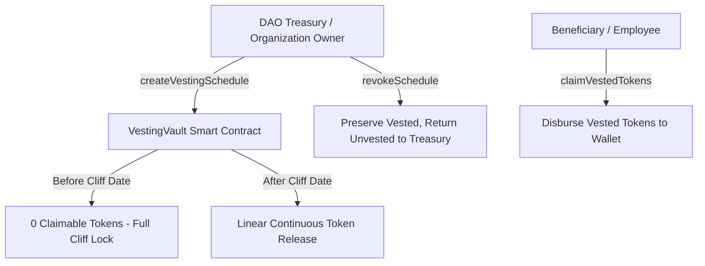

# VestingVault — Token Vesting & Employee Equity Cliff Management Platform


VestingVault is an institutional-grade ERC20 token vesting and employee equity management system. It models linear vesting releases, cliff lock periods, periodic unlock tranches, claim execution, and organization revocation governance to guarantee token incentive alignment for Web3 foundations, DAOs, and crypto startups.

---

## Token Vesting Architecture



---

## Key Capabilities

1. **Cliff Lock Protection:** Rigorously enforces cliff dates; zero tokens can be claimed by beneficiaries prior to reaching the vesting milestone.
2. **Continuous Linear Release:** Second-by-second linear release formula allowing fractional claims without batch unlocking bottlenecks.
3. **Revocable & Irrevocable Grants:** Support for revocable contributor schedules (protecting against early departures) and irrevocable investor allocations.
4. **Verifiable Audit Logging:** Chronological ledger of all schedule deployments, token claims, and revocation return transactions.
5. **Executive Treasury Console:** Midnight-blue theme with real-time committed pool calculations, cliff timeline indicators, and claim simulators.

---

## Technology Stack

- **Smart Contracts:** Solidity `^0.8.20`, OpenZeppelin SafeMath and AccessControl patterns
- **Backend Service:** Node.js 22, Express.js, native `node:sqlite` (WAL mode)
- **Frontend:** Vanilla JavaScript (ES6+), High-Contrast Modern CSS
- **Testing:** Node.js native test runner (`node:test`, `node:assert/strict`)
- **DevOps:** Docker, Docker Compose, GitHub Actions CI

---

## Local Development & Testing

```bash
# Clone the repository
git clone https://github.com/Soulofghost/vestingvault.git
cd vestingvault/backend

# Install dependencies
npm install

# Run automated tests
npm test

# Start the gateway server
npm start
```
Open `http://localhost:4024` to interact with the VestingVault console.

---

## License

SPDX-License-Identifier: MIT  
Copyright (c) 2026 Alvin MS ([@Soulofghost](https://github.com/Soulofghost)).
